<!-- ==================== HEADER ==================== -->

  

  

  
  

 

<!-- ==================== ABOUT ME ==================== -->

  

  

 

<!-- ==================== TECH STACK ==================== -->

  

 

<!-- PROGRAMMING LANGUAGES -->

  

  

 

<!-- TOOLS AND PLATFORMS -->

  

  

 

<!-- GAME DEVELOPMENT -->

  

  

 

<!-- ==================== MACHINE LEARNING ==================== -->

  

  &nbsp;&nbsp;&nbsp;&nbsp;&nbsp;&nbsp;

  

<!-- ==================== GITHUB STATISTICS ==================== -->

  

  
  

 

<!-- CONTRIBUTION STREAK -->

  

 

<!-- CONTRIBUTION GRAPH -->

  

 

<!-- ==================== CONNECT WITH ME ==================== -->

  

  
  &nbsp;
  
  &nbsp;
  

  

<!-- ==================== FOOTER ==================== -->

